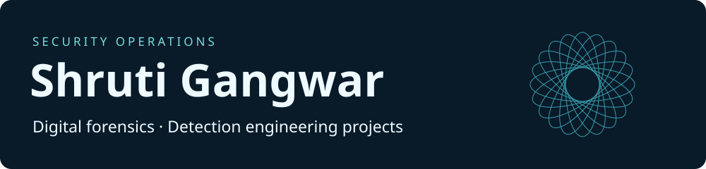

I’m a digital forensics intern preparing for an L1 SOC role. I like questions with evidence behind them: which file changed, what did the scanner see, and what can we reasonably conclude?

[Explore my portfolio](https://artifactshruti.github.io/) · [Connect on LinkedIn](https://www.linkedin.com/in/shruti-gangwar-g1)

### Featured projects

| Project | What you can explore |
| --- | --- |
| [VYRNEXIS AI](https://github.com/ArtifactShruti/vyrnexis-ai) | Defensive SOC and digital forensics workspace with tenant activity dashboards, evidence custody, analyst approvals, and a reproducible synthetic investigation. |
| [Secure File Monitoring Tool](https://github.com/ArtifactShruti/SFMT-v1) | Python file-event monitoring with integrity checks, severity scoring, activity logs and quarantine. |
| [PDF Malware Detection Tool](https://github.com/ArtifactShruti/PDF-Malware-Detection-Tool) | Static inspection of PDF objects with pikepdf and rule-based findings for document triage. |
| [Cyber Tools Hub](https://github.com/ArtifactShruti/Cyber-Tools-Hub) | An HTML learning resource for exploring cybersecurity tools. |

### Technical skills & tools

- **Security operations:** Log analysis, packet inspection with Wireshark, severity classification and incident documentation.
- **Digital forensics:** File-system examination, NTFS/FAT, FTK Imager, OSForensics and Volatility Workbench.
- **Systems & scripting:** Windows, Linux, SSH, Python, pikepdf and basic SQL.

### Experience

**Digital Forensics Intern · CyArt Tech** — October 2026–present, remote  
**Cybersecurity Intern · Unified Mentor Pvt. Ltd.** — May–July 2026, remote

### GitHub statistics

[View current contribution activity](https://github.com/ArtifactShruti#js-contribution-activity).
